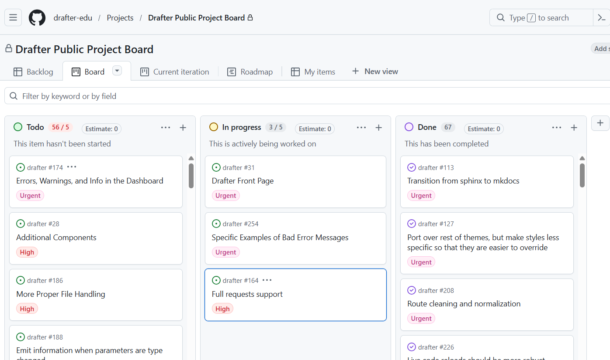

**Topics:** Project boards, User stories, Acceptance criteria

## Learning Objectives

By the end of this section, you will be able to:

- Read and interpret a user story.
- Define clear, testable acceptance criteria.
- Use a project board to track work.

## A Note From Your Mentor

<Email from="Priya Ramachandran, Engineering Lead, Quizzer" subject="Work Sample">

Hi, I'm Priya, the Engineering Lead. I'll be your assigned mentor.

Quizzer is our quiz authoring and delivery tool. The feature that makes it interesting: when learners answer a question, they also report how confident they were. Confident and wrong is the most dangerous state a learner can be in, so Quizzer finds those moments and builds a review queue out of them.

Your work sample is a working slice of Quizzer, built over five weekly epochs. Each epoch has tasks with user stories and acceptance criteria, and each task has tests. The bar is the same one my team uses: it is done when every check passes, not when it seems to work. Just because it works on your laptop, doesn't really matter - unless you're willing to permanently give me your laptop (I could use a new one).

Ask questions early. Nobody here expects you to know everything; we expect you to find out.

Priya

</Email>

## What You Are Building

Quizzer, as your work sample covers it, is a client-side web application where an instructor can author a quiz and a learner can take it: answering questions, reporting confidence, flagging items, and receiving scored results with a review queue that prioritizes high-confidence misconceptions. By the end of epoch 5 it will be fully deployed on GitHub Pages.

You build it in five **epochs**, one per week, each matched to a chapter of this book:

1. Domain types and pure functions, rendered as a static preview.
2. Queries and transformations over quizzes.
3. The first interactive interface.
4. Editing and immutable updates.
5. Scoring, analytics, and the review queue.

Each epoch arrives as a _branch_ in your repository. Merging it adds that epoch's new files and rarely touches code you have already written. The task document under `curriculum/` will be the authoritative description of the work.

## User Stories

Every task in the work sample starts with a **user story**: a one-sentence description of a need, told from the perspective of the person who has it. User Stories are how software engineers outline a deliverable task solicited from a real user. The standard shape is:

> As a _[kind of user]_, I need _[capability]_ so that _[reason]_.

Here is a real one from epoch 1, for a function called `formatPoints`:

> As a learner, I need point values displayed consistently.

A user story deliberately does not say how to build anything. It records who cares and why.

## Acceptance Criteria

A story tells you why; **acceptance criteria** tell you when you are done. They are specific, testable statements. The criteria for `formatPoints` look like this:

- Returns `"1 point"` for 1 and `"<n> points"` otherwise.
- Rejects or documents policy for invalid values.

Notice what makes these usable:

- **Testable.** You can write a test for each one and know, mechanically, whether it passes.
- **Specific.** `"1 point"` with no s. A vague criterion ("displays points nicely") postpones the argument to review time.
- **Bounded.** They also tell you what you are not building. Nothing here asks for localization or styling, so those are out of scope.

In this course, acceptance criteria are backed by tests, some visible to you and some hidden until grading. Chapter 2 has more to say about that arrangement.

Whenever you encounter a user story: read the criteria before the code, and turn each criterion into a test as you satisfy it.

## The Project Board

Every epoch task also exists as a **GitHub issue** in your repository, and the issues are arranged on a **project board** with columns like Backlog, In Progress, and Done. The board answers, at a glance, the question every team constantly asks: what is the state of the work?

Here's how you use it:

- Move a task to "In Progress" when you start it, and limit how many live there at once. **Minimize how many are "in progress".** Work in progress is a cost, not an achievement.
- Move it to "Done" only when it meets the acceptance criteria and definition of done (more on that later), not when it mostly works.
- If a task is blocked, say so on the issue. A silent stuck task looks identical to a forgotten one.

On a real team the board is shared, and keeping it current is how you avoid meetings. Here the team is you, but your peers will see your board when they review your work, and future you will thank present you for the paper trail.

## Coming Up

You cannot merge an epoch branch without a working development environment. The next section sets up Git, Node, and VS Code, and gets your fork of the work sample repository onto your machine.
